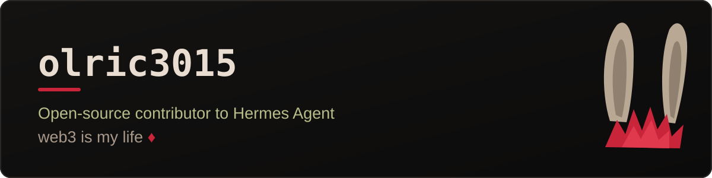
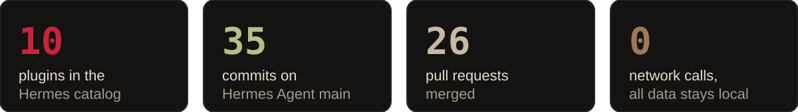

<p align="center">
  
</p>

<p align="center">
  <a href="https://github.com/NousResearch/hermes-agent/commits/main?author=olric3015"></a>
  <a href="https://hermes-agent.nousresearch.com/docs/plugins/by/olric3015"></a>
  <a href="https://github.com/olric3015/hermes-plugins"></a>
</p>

I build small, local plugins for [Hermes Agent](https://github.com/NousResearch/hermes-agent), the open-source agent from Nous Research. Each one hooks into a single point in the agent, keeps a short local ledger, and answers one question with one slash command: which models are slow, which calls fail, how long the agent waits on you, which files it touched. No network, no subprocesses, no credentials; nothing leaves your machine.

<p align="center">
  
</p>

## Plugins

All ten live in one repo, [olric3015/hermes-plugins](https://github.com/olric3015/hermes-plugins), and install by name from the Hermes catalog:

```
hermes plugins install <name> --enable
```

| Plugin | Command | What it tells you |
|---|---|---|
| [**aux-ledger**](https://hermes-agent.nousresearch.com/docs/plugins/aux-ledger) | `/aux` | Every auxiliary LLM call (titles, compression, vision, approvals) by task, model and provider |
| [**stream-speed**](https://hermes-agent.nousresearch.com/docs/plugins/stream-speed) | `/speed` | Time to first text and characters per second for each model |
| [**error-ledger**](https://hermes-agent.nousresearch.com/docs/plugins/error-ledger) | `/errors` | Failed provider requests by model, provider and failure reason |
| [**approval-ledger**](https://hermes-agent.nousresearch.com/docs/plugins/approval-ledger) | `/approval-log` | Approval prompts by rule, with how often each was approved, denied or left unanswered |
| [**command-ledger**](https://hermes-agent.nousresearch.com/docs/plugins/command-ledger) | `/command-log` | Which slash commands you actually use, on which surfaces |
| [**wait-ledger**](https://hermes-agent.nousresearch.com/docs/plugins/wait-ledger) | `/waits` | How long the agent sat waiting on you: approvals, questions, password prompts |
| [**stop-ledger**](https://hermes-agent.nousresearch.com/docs/plugins/stop-ledger) | `/stop-log` | Turns cut short by `/stop` or `/new`, per platform |
| [**voice-ledger**](https://hermes-agent.nousresearch.com/docs/plugins/voice-ledger) | `/voice-log` | Voice recordings sent to speech-to-text, by provider, model and language |
| [**interim-ledger**](https://hermes-agent.nousresearch.com/docs/plugins/interim-ledger) | `/interim-log` | Progress messages the agent sends mid-turn, even where the display hides them |
| [**edit-ledger**](https://hermes-agent.nousresearch.com/docs/plugins/edit-ledger) | `/edit-log` | Files the agent changed per turn, by file type |

Every plugin is tested on Linux, macOS and Windows, and end to end against both the oldest supported Hermes release and current `main` in CI.

<table>
  <tr>
    <td width="50%"><a href="https://hermes-agent.nousresearch.com/docs/plugins/stream-speed"></a></td>
    <td width="50%"><a href="https://hermes-agent.nousresearch.com/docs/plugins/error-ledger"></a></td>
  </tr>
  <tr>
    <td width="50%"><a href="https://hermes-agent.nousresearch.com/docs/plugins/wait-ledger"></a></td>
    <td width="50%"><a href="https://hermes-agent.nousresearch.com/docs/plugins/edit-ledger"></a></td>
  </tr>
</table>

## Toolbox

<p>
  
  
  
</p>
